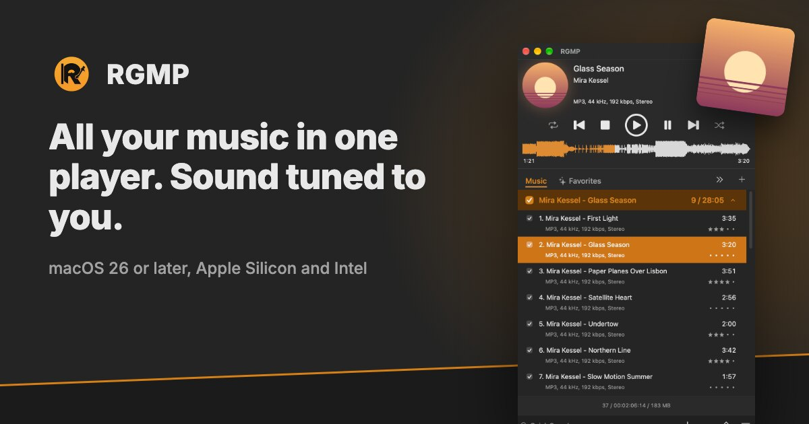
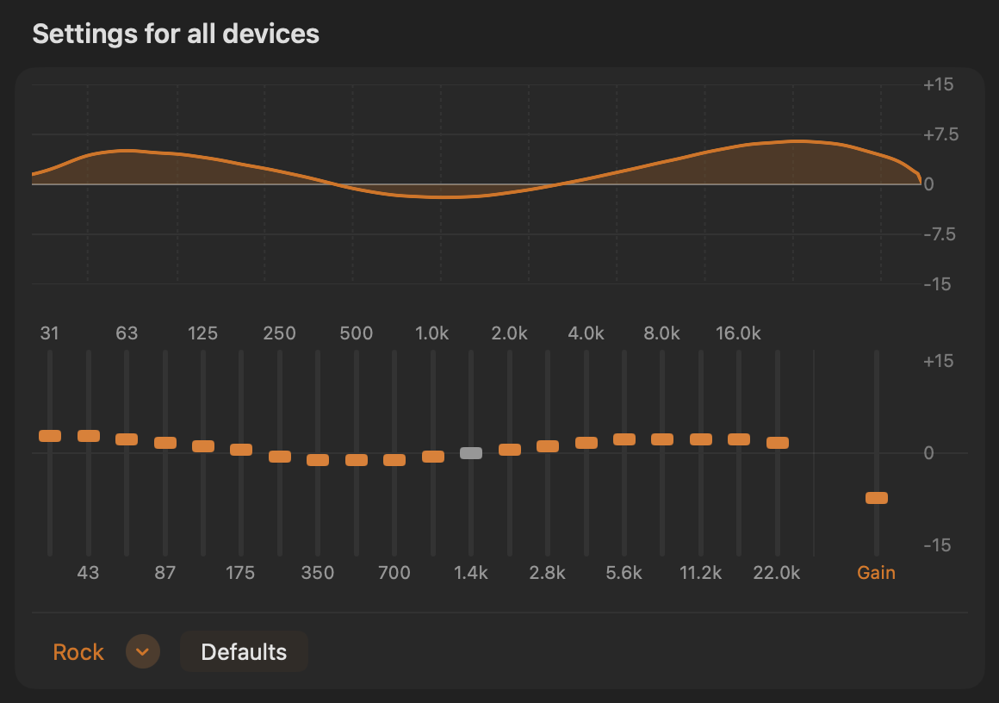
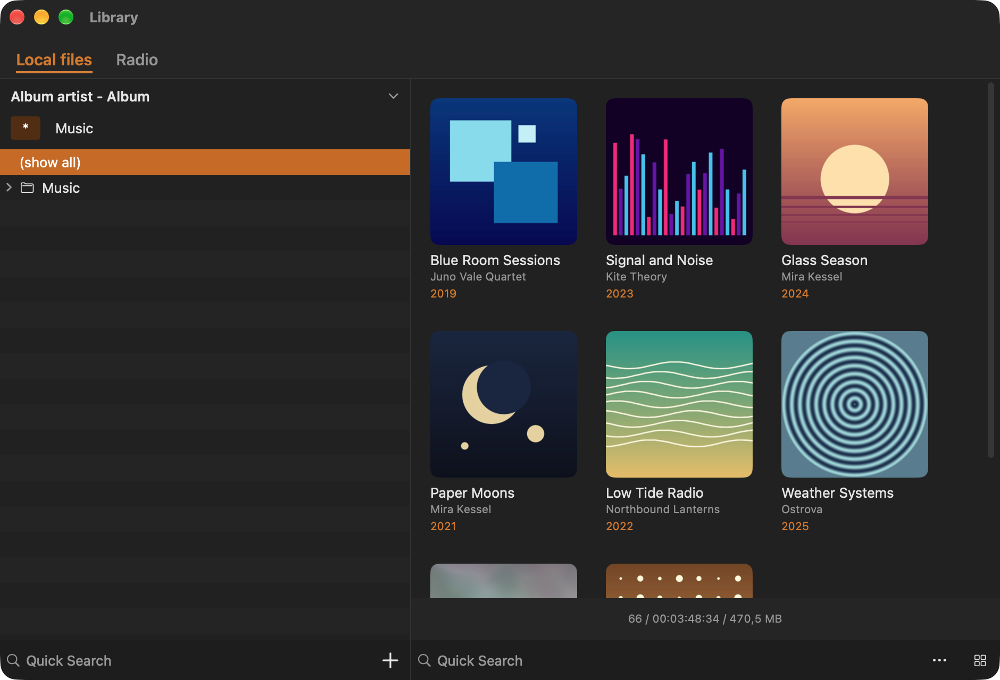
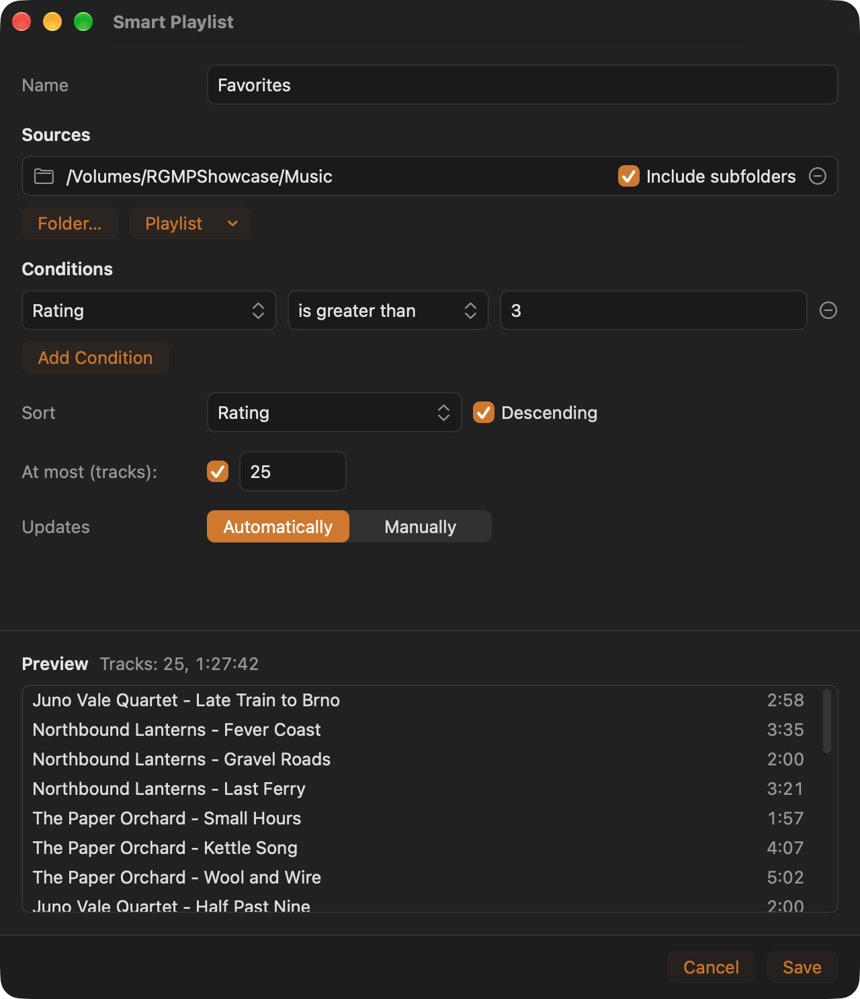
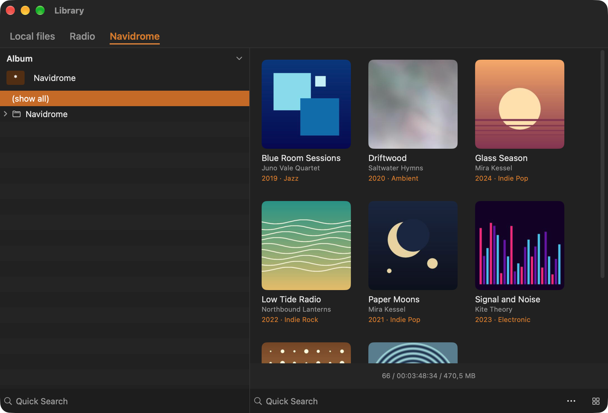
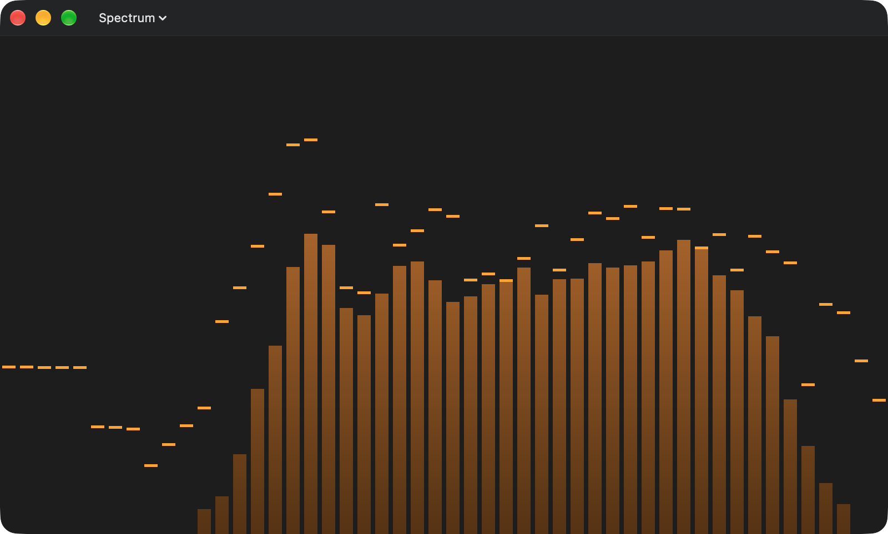
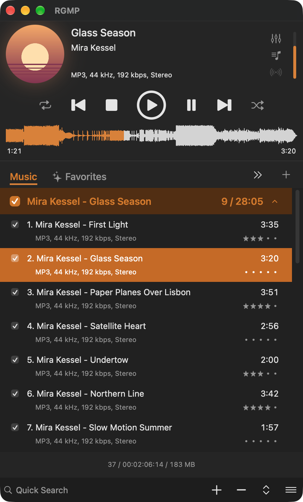
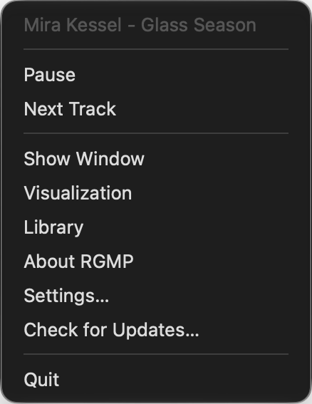
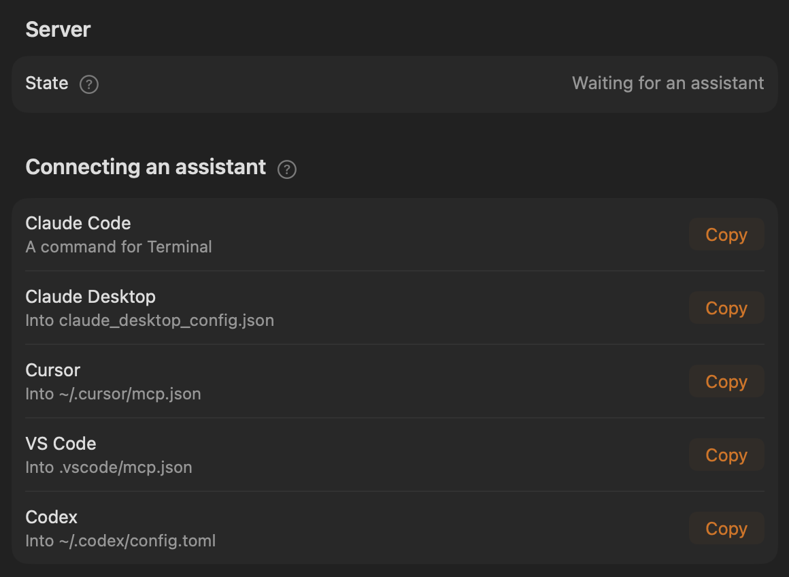

<p align="center">
  <a href="https://rgmp.app"></a>
</p>

<p align="center">
  <b>A free music player for macOS.</b><br>
  Files on your disk, your own Navidrome server, internet radio from around the world, YouTube and
  Yandex Music, in one native app with a 20-band equalizer.
</p>

<p align="center">
  <a href="https://rgmp.app"><b>rgmp.app</b></a>
  &nbsp;&middot;&nbsp;
  <a href="https://github.com/gewisser/RGMP-releases/releases"><b>Download</b></a>
  &nbsp;&middot;&nbsp;
  <a href="#the-first-launch">First launch</a>
  &nbsp;&middot;&nbsp;
  <a href="https://github.com/gewisser/RGMP-releases/issues/new/choose">Report a problem</a>
</p>

<p align="center">
  <b>English</b> &middot; <a href="README.ru.md">Русский</a>
</p>

<p align="center">
  
  
  
  
</p>

RGMP is for people who keep a music collection and care how it sounds. It plays your files, your
Navidrome server and internet radio side by side, tunes the sound with an equalizer that remembers
a curve for each pair of headphones, and keeps its library in step with your folders as they
change. If you used AIMP on Windows, it will feel familiar: RGMP was inspired by
[AIMP](https://aimp.ru) and borrowed features from it.

No account, no subscription, no ads.

<table>
  <tr>
    <td align="center"><h3>20</h3>equalizer bands</td>
    <td align="center"><h3>11</h3>built-in sound effects</td>
    <td align="center"><h3>36</h3>hotkey commands that work from any app</td>
    <td align="center"><h3>8</h3>formats to record radio to</td>
  </tr>
</table>

## Sound tuned to your ears

<p align="center">
  
</p>

The 20-band equalizer can keep a curve of its own for each output device: one for your headphones,
another for your speakers, switched on by itself when the sound goes there.

- Eleven built-in effects: echo, reverb, flanger, chorus, bass, stereo width, a low-pass and
  high-pass filter, speed, tempo, pitch and vocal suppression
- AudioUnit and VST3 effects in one chain over everything you play
- Loudness normalization, and silence removed at the edges and inside a track
- Crossfades between tracks, and soft pauses and seeks

## A library that keeps up with your folders

<p align="center">
  
</p>

Add your music folders and the Local Files tab shows them in ten groupings. A new file turns up by
itself, and one renamed in Finder keeps its play count and its rating.

- Search across the whole collection
- Play counts, and ratings written into the file's tags
- An internet radio catalog by country, language and genre
- Recording a station to eight formats

## Playlists that build themselves

<p align="center">
  
</p>

A smart playlist takes tracks from folders and playlists by a rule: by genre, year, rating, play
count and other fields, with a sort order and a limit. A file dropped into one of its folders turns
up in it a second or two later.

- Tabs, and groups by folder, artist or album
- A play queue drawn from any playlist
- A five-star rating right in the row
- A checkbox per track: it stays in the playlist but is not played

## Your own server, radio and links

<p align="center">
  
</p>

The [Navidrome](https://www.navidrome.org/) plugin plays music from your own server alongside your
files, downloads albums and playlists to listen offline, and keeps stars, favorites and playlists in
step both ways.

- Navidrome: quality chosen by the network, playback resumed after a dropout
- YouTube and YouTube Music by link
- Yandex Music: links, playlist import, FLAC
- A scrobbler for Last.fm and ListenBrainz

## Pictures to the music

<p align="center">
  
</p>

A visualization window of its own: resize it, move it to a second display or take it full screen.
The built-in Spectrum draws bars with falling peaks, and the projectM plugin adds thousands of
Milkdrop presets.

- Follows the music, not the volume: the equalizer shows, a turned-down volume does not
- Presets change by themselves, every 30 seconds by default
- Search the presets, and leave whole themes out

## At home on the Mac

<p align="center">
  
  &nbsp;&nbsp;
  
</p>

A menu bar item, the media keys, Control Center and Now Playing, a mini player and 36 commands for
hotkeys that work from any app.

- Light, dark or system appearance, and a color of your own
- Window scale from 90 to 150%
- Five interface languages: English, Russian, German, French and Japanese
- Apple Silicon and Intel, macOS 26 or later

## An AI assistant at the controls

<p align="center">
  
</p>

The built-in MCP server lets an assistant that can connect to MCP servers run the player: start a
track, find music in the library, build a playlist or a smart playlist, adjust the equalizer. It is
off by default.

- A ready-made setup line for each assistant
- Edits tags only after asking, and can put the old ones back
- If the player is closed, the assistant starts it, without a window

## Plugins

They install from inside the player, Settings -> Plugins -> Add-ons, with one button. Each one is
verified with the same signing key as the player's updates, and updates by itself.

| Plugin | What it does |
| --- | --- |
| Navidrome | Plays the music of your own Navidrome servers |
| YouTube Support | YouTube videos, playlists and channels by link, with covers, and new videos as they come out |
| Yandex Music | Yandex Music tracks, albums and playlists, by link or imported from your account |
| Scrobbler | Sends the tracks you listen to to Last.fm and ListenBrainz |
| projectM | Milkdrop visualization: thousands of presets in the Visualization window |

## Privacy

RGMP sends anonymous usage statistics and crash reports, so that what gets worked on is what people
actually use. Either can be switched off in Settings -> Player -> Privacy. Track titles, tags and
artwork, file paths and folder names, playlist names, station addresses and the names of your
output devices are never sent. The whole story is the
[Privacy Policy](https://rgmp.app/privacy).

## Getting it

1. Download the `.dmg` from [rgmp.app](https://rgmp.app) or from
   [Releases](https://github.com/gewisser/RGMP-releases/releases).
2. Double-click it. A window opens with RGMP in it, next to your Applications folder.
3. Drag RGMP across, then eject the disk image.

The `.zip` next to the image is what an installed copy downloads when it updates itself, so there
is no reason to take that one by hand.

macOS 26 or newer. Universal build: Apple Silicon and Intel. Every version so far is a test version.

## The first launch

RGMP is ad-hoc signed and is **not** notarized, so macOS refuses to open it the first time. That is
expected, and it happens once:

1. Double-click RGMP. macOS shows a window saying "RGMP.app Not Opened", with two buttons. Click
   "Done". The blue "Move to Trash" is the default button: Return presses it, and RGMP goes to the
   Trash.
2. System Settings -> Privacy & Security, the Security section -> "Open Anyway". The button stays
   there for about an hour after the attempt to open RGMP.
3. Confirm with your account password. If macOS asks "Open RGMP.app?", click "Open".

The same thing in one Terminal command:

```
xattr -dr com.apple.quarantine /Applications/RGMP.app
```

## Updating

The second time RGMP is opened, it asks whether it may check for new versions by itself. If you
agree, it checks this repository once a day. You can also ask it to check at any time: "Check for
Updates..." in the application menu, or the Updates pane in its settings.

Every update is verified against a signing key built into the copy you already have, so an archive
that has been altered on the way will not install. That check is not Apple's, and it does not make
the build notarized; what it does mean is that an update can only come from whoever holds the key
this build was published with.

Test versions go to a channel of their own. A copy installed from a test version is offered the
test versions that follow as well; any other copy only gets released versions. "Update to" in the
same settings pane switches between the two.

## Reporting a problem

Open an [issue](https://github.com/gewisser/RGMP-releases/issues/new/choose) and pick the form that
fits. The About RGMP window, the first item of the RGMP menu, shows the version, the Mac and the
macOS line a bug report asks for, and they can be copied from there.

The log is at `~/Library/Application Support/gewisser.rgmp/Logs/RGMP.log`. Attaching it to a bug
report usually saves a round of questions.

---

This repository carries the downloads and the update feed of RGMP; the player's source code is not
here.
