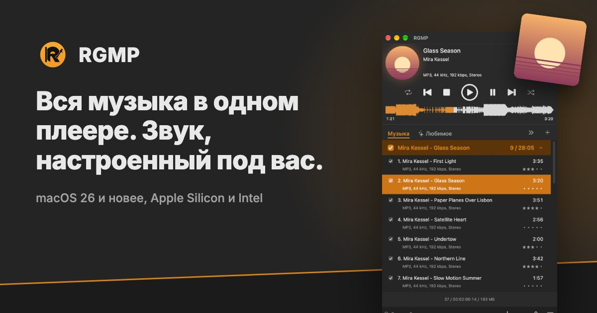
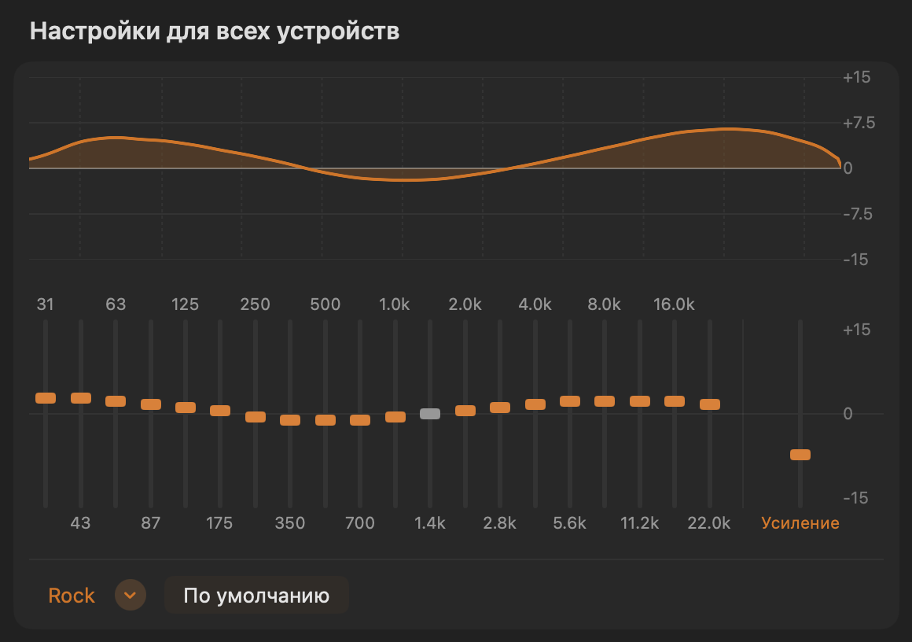
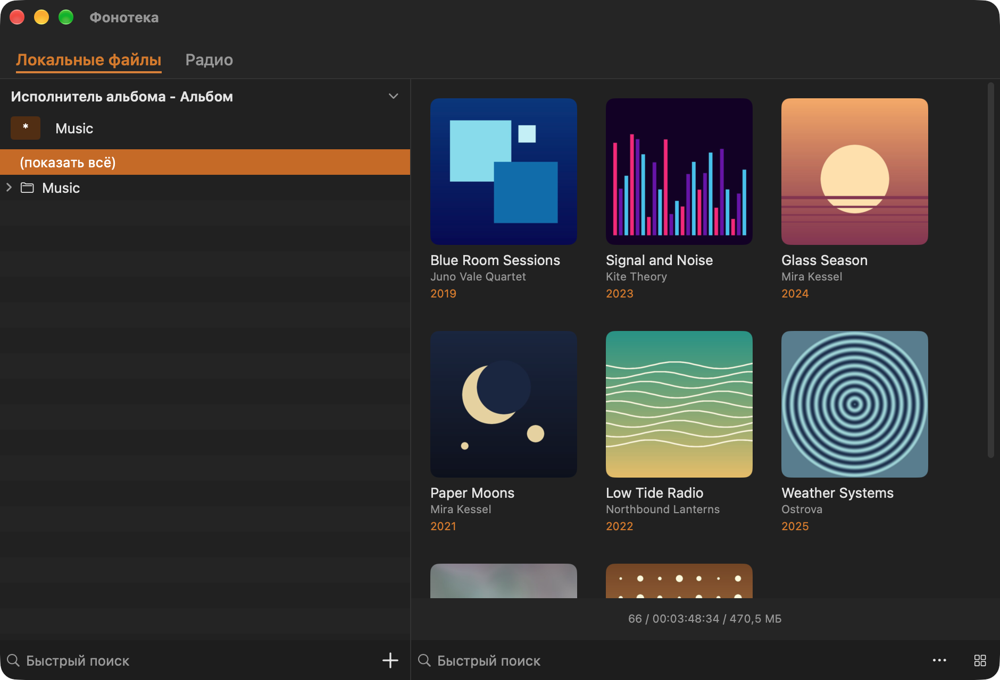
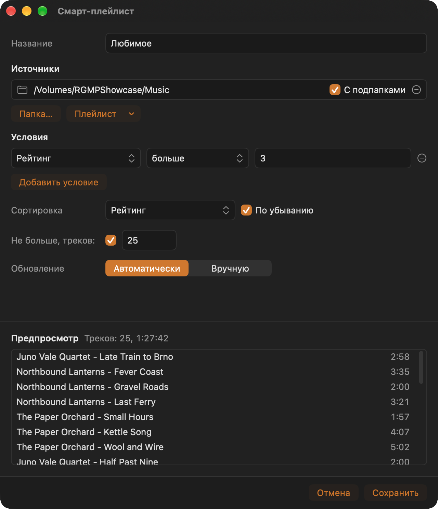
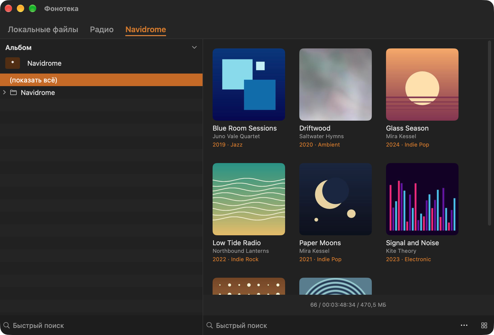
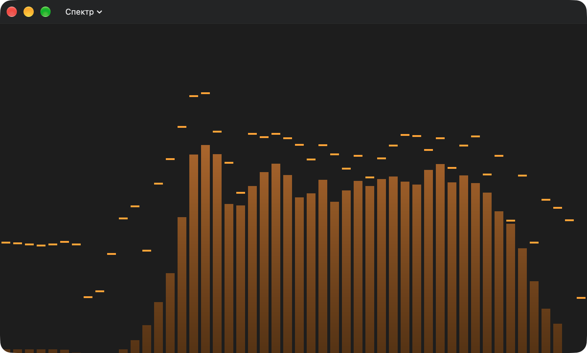
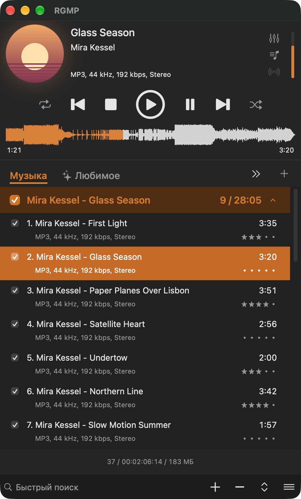
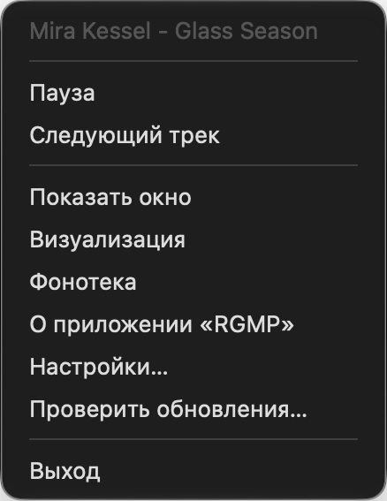
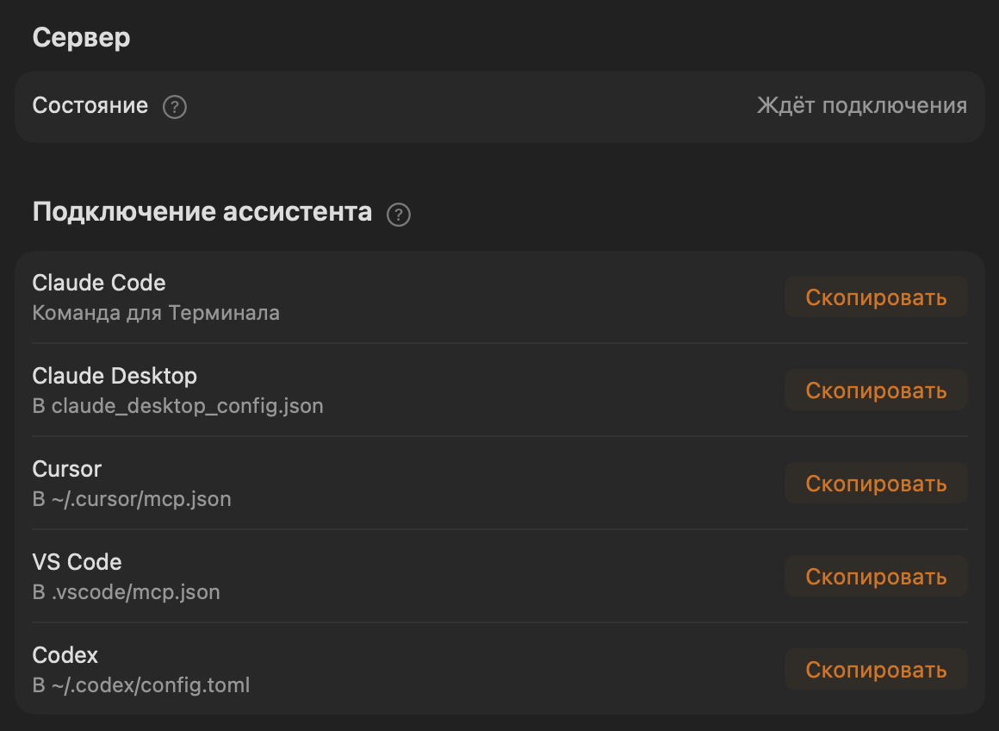

<p align="center">
  <a href="https://rgmp.app/ru"></a>
</p>

<p align="center">
  <b>Бесплатный музыкальный плеер для macOS.</b><br>
  Файлы с диска, свой сервер Navidrome, интернет-радио со всего мира, YouTube и Яндекс Музыка в
  одной нативной программе с эквалайзером на 20 полос.
</p>

<p align="center">
  <a href="https://rgmp.app/ru"><b>rgmp.app</b></a>
  &nbsp;&middot;&nbsp;
  <a href="https://github.com/gewisser/RGMP-releases/releases"><b>Скачать</b></a>
  &nbsp;&middot;&nbsp;
  <a href="#первый-запуск">Первый запуск</a>
  &nbsp;&middot;&nbsp;
  <a href="https://forum.rgmp.app/new-topic?category=rgmp/bugs">Сообщить о проблеме</a>
</p>

<p align="center">
  <a href="README.md">English</a> &middot; <b>Русский</b>
</p>

<p align="center">
  
  
  
  
</p>

RGMP сделан для тех, кто собирает музыку и кому важно, как она звучит. Он играет файлы с диска,
ваш сервер Navidrome и интернет-радио вперемешку, настраивает звук эквалайзером, который помнит
свою кривую для каждых наушников, и сам следит за папками фонотеки. Если вы пользовались AIMP на
Windows, многое покажется знакомым: RGMP вдохновлялся плеером [AIMP](https://aimp.ru) и заимствовал
у него функции.

Без аккаунта, подписки и рекламы.

<table>
  <tr>
    <td align="center"><h3>20</h3>полос эквалайзера</td>
    <td align="center"><h3>11</h3>встроенных звуковых эффектов</td>
    <td align="center"><h3>36</h3>команд для горячих клавиш из любой программы</td>
    <td align="center"><h3>8</h3>форматов записи радио</td>
  </tr>
</table>

## Звук под ваши уши

<p align="center">
  
</p>

Эквалайзер на 20 полос может помнить свою кривую для каждого устройства вывода: у наушников одна,
у колонок другая, и она включается сама, когда звук уходит на это устройство.

- Одиннадцать встроенных эффектов: эхо, реверберация, фланжер, хорус, бас, стереобаза, фильтр
  низких и высоких частот, скорость, темп, тональность и подавление голоса
- Эффекты AudioUnit и VST3 в одной цепочке на весь звук
- Нормализация громкости и удаление тишины на краях и внутри трека
- Сведение треков и мягкие паузы и перемотка

## Фонотека, которая следит за папками сама

<p align="center">
  
</p>

Добавьте папки с музыкой, и вкладка "Локальные файлы" покажет их в десяти группировках. Новый
файл появится сам, а переименованный в Finder сохранит прослушивания и оценку.

- Поиск по всей коллекции
- Статистика прослушиваний и оценка в тегах файла
- Каталог интернет-радио: страны, языки и жанры
- Запись эфира в восемь форматов

## Плейлисты, которые собираются сами

<p align="center">
  
</p>

Смарт-плейлист берёт треки из папок и плейлистов по правилу: по жанру, году, оценке, числу
прослушиваний и другим полям, с сортировкой и лимитом. Файл, положенный в его папку, появится в нём
через секунду-другую.

- Вкладки и группы по папкам, исполнителям или альбомам
- Очередь воспроизведения из любого плейлиста
- Оценка в пять звёзд прямо в строке
- Флажок у трека: остаётся в плейлисте, но не играет

## Свой сервер, радио и ссылки

<p align="center">
  
</p>

Плагин [Navidrome](https://www.navidrome.org/) играет музыку с вашего сервера вперемешку с файлами,
скачивает альбомы и плейлисты для прослушивания без сети и синхронизирует звёзды, избранное и
плейлисты в обе стороны.

- Navidrome: качество по сети и продолжение после обрыва
- YouTube и YouTube Music по ссылке
- Яндекс Музыка: ссылки, импорт плейлистов, FLAC
- Скробблер для Last.fm и ListenBrainz

## Картинка под музыку

<p align="center">
  
</p>

Своё окно визуализации: тянется, уходит на второй монитор и разворачивается на весь экран.
Встроенный "Спектр" рисует столбики с гаснущими пиками, а плагин projectM добавляет тысячи
пресетов Milkdrop.

- Слушает музыку, а не громкость: эквалайзер виден, убавленный звук не мешает
- Пресет меняется сам, по умолчанию раз в 30 секунд
- Поиск по пресетам и темы, которые можно исключить

## Как дома на Mac

<p align="center">
  
  &nbsp;&nbsp;
  
</p>

Значок в строке меню, медиаклавиши, Пункт управления и "Исполняется", мини-плеер и 36 команд для
горячих клавиш, которые работают из любой программы.

- Светлая, тёмная или системная тема и свой цвет
- Масштаб окон от 90 до 150 %
- Пять языков интерфейса: русский, английский, немецкий, французский и японский
- Apple Silicon и Intel, macOS 26 и новее

## ИИ-ассистент за пультом

<p align="center">
  
</p>

Встроенный MCP-сервер даёт ассистенту, который умеет подключать MCP-серверы, управлять плеером:
включить трек, найти музыку в фонотеке, собрать плейлист или смарт-плейлист, поправить эквалайзер.
По умолчанию он выключен.

- Готовая строка настройки для каждого ассистента
- Теги правит, только переспросив, и может вернуть прежние
- Если плеер закрыт, ассистент откроет его сам, без окна

## Плагины

Ставятся из самого плеера: Настройки -> Плагины -> Дополнения, одной кнопкой. Каждый проверяется
тем же ключом подписи, что и обновления плеера, и обновляется сам.

| Плагин | Что делает |
| --- | --- |
| Navidrome | Играет музыку с ваших серверов Navidrome |
| YouTube Support | Видео, плейлисты и каналы YouTube по ссылке, с обложками и новыми видео, как только они выходят |
| Яндекс Музыка | Треки, альбомы и плейлисты Яндекс Музыки, по ссылке или импортом из аккаунта |
| Скробблер | Отправляет прослушанные треки в Last.fm и ListenBrainz |
| projectM | Визуализация Milkdrop: тысячи пресетов в окне визуализации |

## Конфиденциальность

RGMP отправляет анонимную статистику использования и отчёты о сбоях, чтобы работа шла над тем, чем
действительно пользуются. И то и другое выключается в Настройки -> Плеер -> Конфиденциальность.
Никогда не отправляются названия треков, теги и обложки, пути к файлам и имена папок, названия
плейлистов, адреса станций и имена ваших устройств вывода. Подробности в
[Privacy Policy](https://rgmp.app/privacy) (на английском).

## Как поставить

1. Скачайте `.dmg` с [rgmp.app](https://rgmp.app/ru) или со страницы
   [Releases](https://github.com/gewisser/RGMP-releases/releases).
2. Откройте скачанный образ: в окне будут RGMP и папка "Программы".
3. Перетащите RGMP в папку "Программы" и извлеките образ.

`.zip` рядом с образом скачивает уже установленная копия, когда обновляется сама, так что брать
его руками незачем.

macOS 26 и новее. Универсальная сборка: Apple Silicon и Intel. Пока все версии тестовые.

## Первый запуск

RGMP подписан ad-hoc и не нотаризован Apple, поэтому в первый раз macOS откажется его открыть. Так
и должно быть, и делается это один раз:

1. Откройте RGMP двойным щелчком. macOS покажет окно "Файл RGMP.app не был открыт" с двумя
   кнопками. Нажмите "Готово". Синяя кнопка "Переместить в Корзину" стоит по умолчанию: клавиша
   Return нажмёт её, и программа уйдёт в Корзину.
2. Системные настройки -> Конфиденциальность и безопасность, раздел "Безопасность" -> "Все равно
   открыть". Кнопка видна около часа после попытки запуска.
3. Введите пароль учётной записи. Если macOS спросит "Открыть файл RGMP.app?", нажмите "Открыть".

То же самое одной командой в Терминале:

```
xattr -dr com.apple.quarantine /Applications/RGMP.app
```

## Обновления

При втором запуске RGMP спросит, можно ли ему самому проверять новые версии. Если согласиться, он
будет раз в сутки проверять этот репозиторий. Спросить можно и самому: "Проверить обновления..." в
меню программы или раздел "Обновления" в настройках.

Каждое обновление, в том числе плагина, проверяется по ключу, зашитому в ту копию, которая уже
стоит, поэтому подменённый по дороге архив не установится. Это проверка не от Apple, и
нотаризованной сборку она не делает; зато обновление может прийти только от того, у кого есть ключ,
которым подписана эта сборка.

У тестовых версий свой канал. Копии, поставленной из тестовой версии, предлагаются и следующие
тестовые; остальные получают только выпущенные версии. Изменить это можно в тех же настройках,
пункт "Обновляться до".

## Сообщить о проблеме

Ошибки, вопросы и предложения - на [форум](https://forum.rgmp.app). В RGMP пункт меню Справка ->
Сообщить о проблеме открывает там [сообщение об ошибке](https://forum.rgmp.app/new-topic?category=rgmp/bugs),
где версия, macOS и Mac уже заполнены, а журнал показывает в Finder - его остаётся перетащить в
форму. Иначе их показывает окно "О приложении RGMP", первый пункт
меню RGMP, и их можно скопировать оттуда.

Журнал лежит в `~/Library/Application Support/gewisser.rgmp/Logs/RGMP.log`. Если приложить его к
сообщению об ошибке, обычно не придётся отвечать на лишние вопросы.

Если удобнее GitHub, [issues](https://github.com/gewisser/RGMP-releases/issues/new/choose) тоже читаются.

---

В этом репозитории лежат загрузки и лента обновлений RGMP; исходного кода плеера здесь нет.
